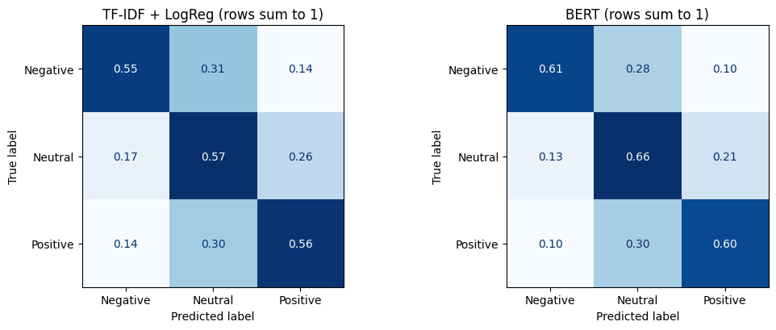
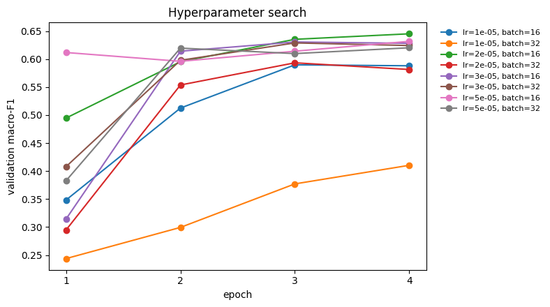

# Crypto Sentiment BERT

Sentiment analysis (negative / neutral / positive) for cryptocurrency-related
Reddit comments, powered by a `bert-base-uncased` model fine-tuned on ~3,000
labeled comments and served behind a FastAPI endpoint.

The fine-tuned model is loaded from the Hugging Face Hub
(`baz08/crypto-sentiment-bert` by default; set `MODEL_REPO` to override).

## Results

Evaluated on a held-out, label-stratified test set of 589 comments (20% of
the data, seed 42), with two baselines for comparison:

| Model | Accuracy | Macro-F1 | F1 Negative | F1 Neutral | F1 Positive |
|---|---:|---:|---:|---:|---:|
| Majority class (always "neutral") | 47.2% | 0.214 | 0.000 | 0.641 | 0.000 |
| TF-IDF + logistic regression | 56.4% | 0.555 | 0.525 | 0.599 | 0.542 |
| **Fine-tuned BERT (tuned)** | **63.2%** | **0.624** | **0.608** | **0.664** | **0.599** |



- **BERT beats both baselines on every class**: +6.8 points of accuracy and
  +0.07 macro-F1 over TF-IDF. With 589 test rows, one run's accuracy is
  uncertain by roughly ±4 points, so treat the exact margin as approximate.
- **Most errors involve the neutral class.** 28% of truly negative and 30%
  of truly positive comments were predicted neutral, while only about 10%
  were flipped to the opposite sentiment.
- **Accuracy depends heavily on the data source:**

  | Source | Test rows | BERT accuracy |
  |---|---:|---:|
  | `sentiment.csv` (positive/negative only) | 121 | 81.0% |
  | `sentiment_labels.csv` | 195 | 63.1% |
  | `ETH_comments.csv` | 105 | 59.0% |
  | `BTC_comments.csv` | 168 | 53.0% |

  The two-class source is easiest because it has no neutral examples to
  confuse; the scraped BTC comments are hardest.

### Hyperparameter search

Learning rate and batch size were tuned on a validation split carved out of
the training data (15%, never the test set), training each combination for
up to 4 epochs and scoring macro-F1 after every epoch:



The best config was **lr 2e-5, batch size 16, 4 epochs** (validation
macro-F1 0.645). Most settings level off around 0.60–0.63 by epoch 3; the
clear outlier is lr 1e-5 with batch size 32, which learns too slowly to
converge in 4 epochs. Tuning improved the test score over the untuned
2-epoch run (62.0% / 0.607) by about one point, which is within run-to-run
noise: the main gain came from training longer.

Final training: 4 epochs, batch size 16, AdamW (lr 2e-5, weight decay 0.01,
linear warmup/decay), max 256 tokens, on a Colab T4 GPU. Full code, plots
and error analysis are in
[`notebooks/02_train_evaluate.ipynb`](notebooks/02_train_evaluate.ipynb).

## Run it on Google Colab

| Notebook | What it does | Runtime |
|---|---|---|
| [`01_data_pipeline`](notebooks/01_data_pipeline.ipynb) [](https://colab.research.google.com/github/baz08/crypto-sentiment-bert/blob/main/notebooks/01_data_pipeline.ipynb) | Cleans and merges the labeled sources into `Crypto_c.csv`, with label/length charts | CPU, < 1 min |
| [`02_train_evaluate`](notebooks/02_train_evaluate.ipynb) [](https://colab.research.google.com/github/baz08/crypto-sentiment-bert/blob/main/notebooks/02_train_evaluate.ipynb) | Optional hyperparameter search, fine-tunes BERT, compares it with majority-class and TF-IDF baselines, error analysis, optional push to the Hub | T4 GPU, a few minutes |

Each notebook clones this repo for the data, so they run as-is with no setup.

## Quickstart: run the API

```bash
cd deployment/api
docker build -t crypto-sentiment-bert .
docker run -p 8000:8000 crypto-sentiment-bert
```

The first run downloads the fine-tuned model from the Hugging Face Hub, so
expect it to take a minute or two before the server is ready.

Once it's up:

```bash
curl -X POST http://localhost:8000/predict \
  -H "Content-Type: application/json" \
  -d '{"text": "I love bitcoin"}'
# {"sentiment":"Positive"}
```

Interactive API docs (Swagger UI) are available at
http://localhost:8000/docs, and a `GET /health` endpoint is available for
readiness checks.

| URL              | Method | Description                                  |
|-------------------|--------|-----------------------------------------------|
| `/predict`         | POST   | Run sentiment analysis on the provided text   |
| `/health`          | GET    | Liveness/readiness check                      |

## Project structure

```
├── deployment
│   ├── api                  - FastAPI service
│   │   ├── main.py            - API routes
│   │   ├── ML
│   │   │   ├── predmodel.py   - loads the fine-tuned BERT model from the Hub
│   │   │   └── textprep.py    - input cleaning (copy of reddit/textprep.py)
│   │   ├── Dockerfile
│   │   └── requirements.txt
│   ├── bert_training         - model training
│   │   ├── berttest.py        - train/evaluate the classifier
│   │   ├── requirements.txt
│   │   └── WRITEUP.md         - training methodology and results
│   ├── reddit                - data collection & preprocessing
│   │   ├── redditpushshift.py - how comments were scraped (Pushshift; no longer works)
│   │   ├── *.csv              - frozen labeled data snapshot (2022)
│   │   ├── textprep.py        - light cleaning used for training AND inference
│   │   ├── cleaner.py         - bag-of-words normalization (for non-BERT baselines)
│   │   ├── merge_clean.py     - merge the labeled sources into Crypto_c.csv
│   │   └── requirements.txt
│   └── docs
│       ├── images             - figures used in this README
│       └── UCSD ML Capstone.pdf
├── notebooks                 - Colab versions of the pipeline and training
└── tests                     - unit tests for the API and data pipeline
```

## Training

The API loads an already fine-tuned model from the Hub, so training is only
needed if you want to reproduce or improve it. See
[`deployment/bert_training/WRITEUP.md`](deployment/bert_training/WRITEUP.md)
for the full methodology, and run it with:

```bash
cd deployment/bert_training
pip install -r requirements.txt
python berttest.py --data ../reddit/Crypto_c.csv --output-dir ./model --push-to-hub baz08/crypto-sentiment-bert
```

To tune hyperparameters first, add `--search`: it tries every learning rate ×
batch size in the grid (scoring each epoch up to `--max-epochs`) on a
validation split carved out of the training data, then trains the final
model with the best config. The test set is never used for tuning. Use
`--n-trials N` to try a random subset; the full default grid takes about
30–40 minutes on a T4.

Training uses PyTorch (`transformers` v5 dropped TensorFlow support). The
script holds out a shuffled, label-stratified 20% test split (fixed
seed), reports accuracy and macro-F1 alongside a majority-class baseline and a
TF-IDF + logistic regression baseline,
and writes everything to `metrics.json`.

### Data

`deployment/reddit/Crypto_c.csv` (2,942 labeled comments/posts) is checked
in and is built from four labeled sources by:

```bash
cd deployment/reddit
python merge_clean.py
```

which also prints the label counts per source. The comments were originally
collected from r/CryptoCurrency in 2022 with `redditpushshift.py`; Reddit
shut off public Pushshift access in 2023, so the CSVs in that folder are a
frozen snapshot rather than something that can be re-scraped.

Training and the API clean text with the same function
(`textprep.clean_for_model`), which only removes URLs, HTML entities, and
encoding artifacts: stopwords, punctuation and casing are left in, since
BERT uses them.

## Tests

```bash
pip install -r requirements-dev.txt
pytest
```

Tests mock the BERT model itself (it's large and network-dependent), so they
run in seconds without downloading any weights.

## Limitations

- **Small, mixed-source dataset.** 2,942 labeled rows from four sources
  that don't share a labeling scheme (one has no neutral class). Label
  noise, especially around "neutral", likely caps accuracy as much as the
  model does.
- **Sarcasm and crypto slang.** "Great, another rug pull. Exactly what I
  needed today." is predicted positive (85% confidence). Misspelled hype
  ("Ethereum needs to pamp !") and buy-the-dip logic ("Maybe bitcoin will go
  back down to 1 cent each. If it does I'm going to buy a bunch!") also trip
  it up.
- **Long posts are truncated** at 256 tokens (about 4% of rows).
- **Frozen 2022 snapshot.** The comments come from mid-2022 and Pushshift
  no longer serves Reddit data, so the model hasn't seen newer slang or
  market conditions.
- **Single run.** Results are from one seed (and the best search config
  sat at the 4-epoch limit, so 5–6 epochs may help slightly); averaging several seeds (or
  cross-validation) would give tighter numbers.

**Next steps:** relabel a sample for consistent neutral guidelines; try a
domain-specific model such as a Twitter/finance-pretrained RoBERTa; add a
sarcasm-heavy evaluation set.

## License

[MIT](LICENSE)
